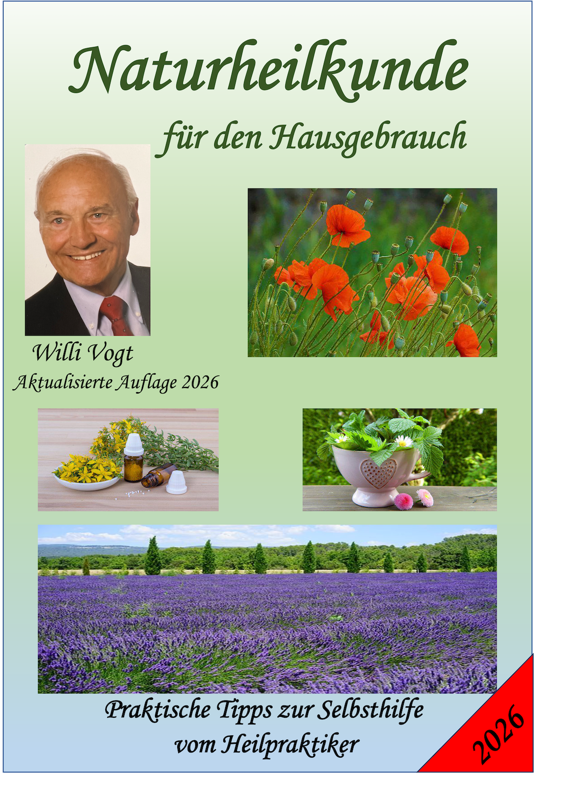
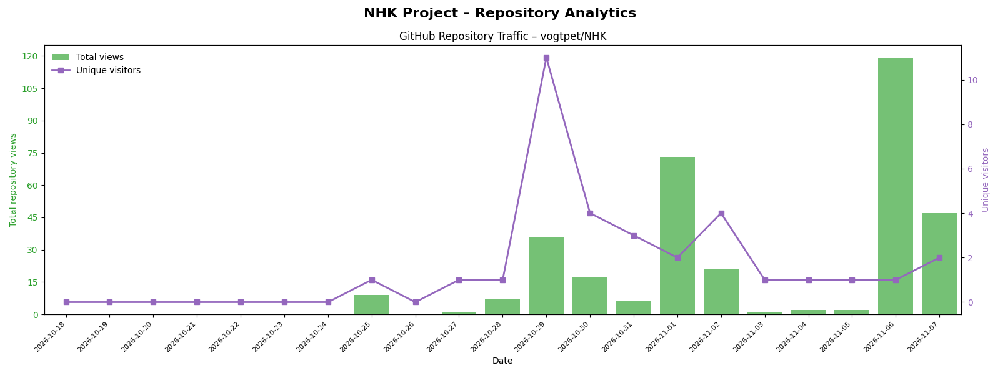

**🌐 [Online lesen](https://vogtpet.github.io/NHK/) · [PDF herunterladen](https://raw.githubusercontent.com/vogtpet/NHK/main/docs/docs/NHK2026.pdf) · [eBook herunterladen](https://raw.githubusercontent.com/vogtpet/NHK/main/docs/docs/NHK2026.epub)**

---

  

Naturheilkunde für den Hausgebrauch
============================ 

## 📥 Download & Online Lesen:
- 🌐 **[Direkt im Browser lesen (Interaktiv)](https://vogtpet.github.io/NHK/)**
- 📄 **[PDF-Version herunterladen (9 MB, Neuauflage 10/2026)](https://raw.githubusercontent.com/vogtpet/NHK/main/docs/docs/NHK2026.pdf)**
- 📄 **[eBook-Version herunterladen (25 MB, Neuauflage 10/2026)](https://raw.githubusercontent.com/vogtpet/NHK/main/docs/docs/NHK2026.epub)**

a) Werk & Urheberschaft:
-----------
Autor: Willi Vogt (1939–2023, ehem. Naturheilpraxis Boppard)  
Mitarbeit: Reinhild Vogt  
Herausgeber: Dr. Peter Vogt  
Aktualisierte Neuauflage: Oktober 2026 · Stand der rechtlichen Hinweise: November 2026

b) Urheberrecht & Veröffentlichung:
-----------
Das Werk wurde ursprünglich im Eigenverlag als kommerzielles E-Book veröffentlicht. Die digitale Neuauflage 2026 wird von Dr. Peter Vogt als Herausgeber unter der Lizenz CC BY 4.0 International frei zur Verfügung gestellt.

c) Lizenzbestimmungen:
-----------
Dieses E-Book steht unter der Lizenz Creative Commons Namensnennung 4.0 International (CC-BY 4.0). Den vollständigen Lizenztext finden Sie unter: https://creativecommons.org/licenses/by/4.0/deed.de. Sie dürfen das E-Book in jedem Format oder Medium vervielfältigen, verändern und weiterverbreiten, sofern Sie den Autor (Willi Vogt), die Mitarbeit (Reinhild Vogt) und den Herausgeber (Dr. Peter Vogt) nennen und einen Link zur Lizenz beifügen.

d) Bild- und Grafiknachweise:
-----------
Umschlagseite: © by Christiane Fischbach  
Grafiken im Text: © by Riccardo Lauri  
Fotos im Text: Bildmaterial von Pixabay (unter Pixabay-Lizenz/Content License)

e) Hinweis zur Barrierefreiheit:
-----------
Dieses E-Book wurde bewusst ohne digitalen Kopierschutz (DRM) veröffentlicht. Das Kopieren, Konvertieren in andere Dateiformate sowie die Nutzung durch assistierende Technologien (wie Screenreader für sehbehinderte Menschen) ist ausdrücklich gestattet und erwünscht.

f) Wichtiger Hinweis & Haftungsausschluss (Medizinischer Disclaimer):
-----------
Die in diesem Buch bereitgestellten Informationen, praktischen Tipps und naturheilkundlicher Verfahren basieren auf den langjährigen Erfahrungen und der praktischen Tätigkeit des Autors als Heilpraktiker. Sie wurden mit größter Sorgfalt zusammengestellt und dienen ausschließlich der allgemeinen Information, der Aufklärung und der Selbsthilfe bei leichten Befindlichkeitsstörungen.

**Kein Ersatz für ärztlichen Rat:**  
Die Inhalte dieses Werkes ersetzen in keinem Fall eine professionelle medizinische Beratung, Diagnose oder Behandlung durch einen approbierten Arzt, Facharzt oder Therapeuten. Suchen Sie bei gesundheitlichen Beschwerden, chronischen Leiden oder anhaltenden Symptomen stets qualifizierten ärztlichen Rat auf.

g) Eigenverantwortung & Haftungsausschluss:
-----------
Die Anwendung der beschriebenen Ratschläge, Hausmittel (z. B. Ölschlürfen, Heißwasser-Trinkkur) und Rezepturen erfolgt ausdrücklich auf eigene Gefahr und in eigener Verantwortung des Lesers. Der Autor, die Mitarbeit sowie der Herausgeber übernehmen keinerlei Haftung für Schäden, Nachteile oder gesundheitliche Beeinträchtigungen, die direkt oder indirekt aus der praktischen Umsetzung der in diesem Buch enthaltenen Informationen resultieren.

h) Herausgeber & Kontakt (Impressum):
-----------
Dr. Peter Vogt, Michael-Bach-Straße 1, 56154 Boppard, Deutschland  
E-Mail: vogtpet@gmail.com  
Website: https://vogtpet.github.io/NHK/  
Impressum: https://vogtpet.github.io/NHK/impressum/  
Datenschutz: https://vogtpet.github.io/NHK/datenschutz/

Bezugsquelle:
===========

Dieses E-Book ist dauerhaft frei und kostenlos erhältlich unter  
https://vogtpet.github.io/NHK/ (Web-Reader, PDF, EPUB) und  
https://github.com/vogtpet/NHK.

Dieses E-Book enthält keine Telemetrie, keine Cookies und keine externen Inhalte; es enthält lediglich Links zu den genannten Websites.

---

## 📊 Repository Traffic

